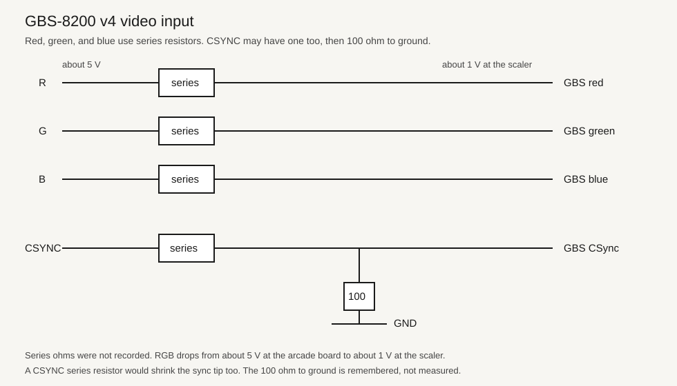
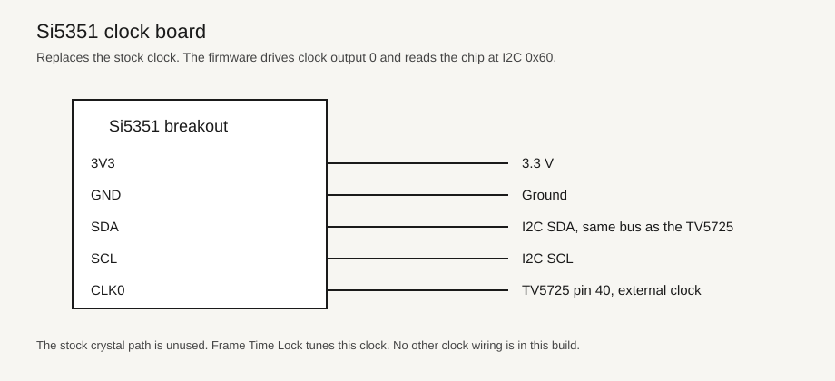
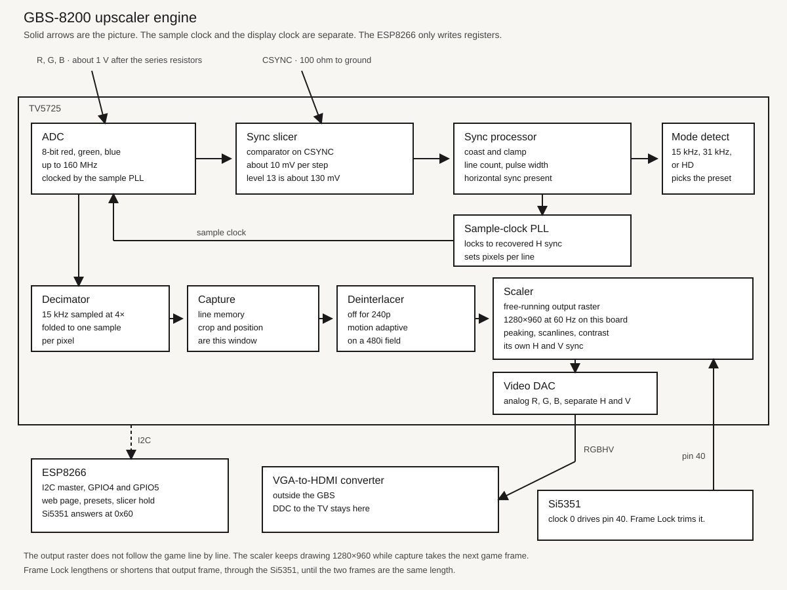
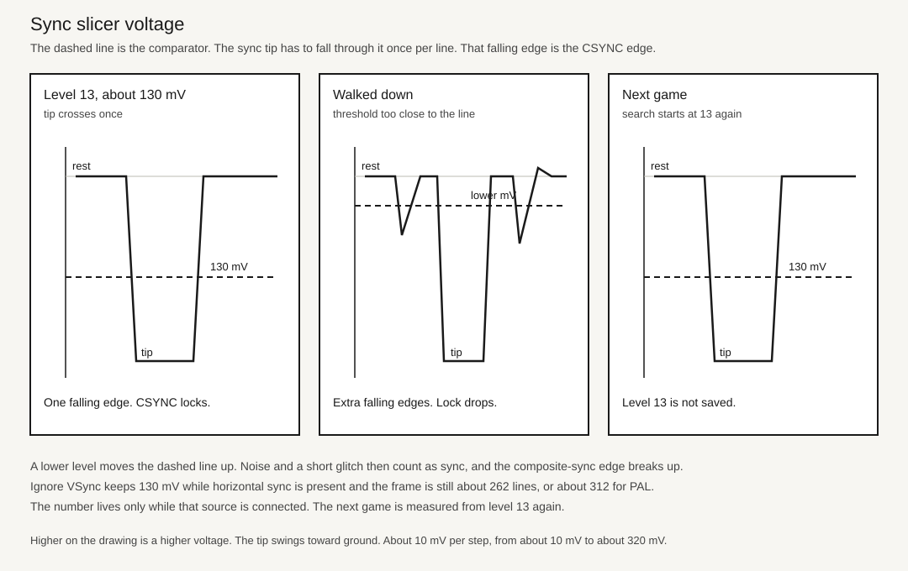
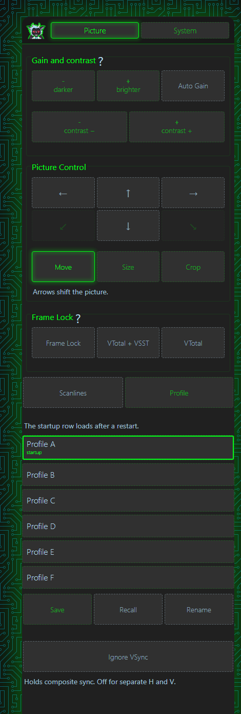
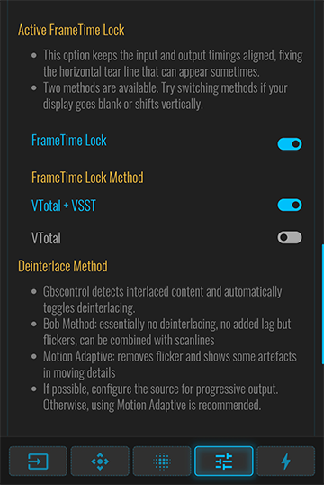

# gbs-control

A simple web page for a GBS-8200 used as a CSYNC RGB upscaler. GPL-3.0.

The hardware was built to take composite-sync RGB, the signal an arcade board puts on one sync pin, and scale it for a modern display. This spinoff keeps that job on one page. There is no OLED and no encoder. The web page is the control.

The board in use is a GBS-8200 v4. The first source is a Primal Rage arcade board. The page title is GBS-Controls.

## Hardware

Two changes on the scaler, and nothing else.

Red, green, and blue each pass through a series resistor. The ohms were not written down. The arcade video is about 5 V, and it arrives at the scaler at about 1 V. CSYNC may have a series resistor of the same kind. That was not written down either. It shrinks the sync tip the same way those resistors shrink the picture. CSYNC is also terminated: about 100 ohm from the scaler side of that wire to ground. That 100 ohm figure is remembered, not measured. A video termination is often 75 ohm.

An Si5351 breakout replaces the stock clock. Clock output 0 goes to TV5725 pin 40. SDA and SCL share the scaler I2C bus, and the chip answers at address `0x60`. The firmware leaves that clock enabled. Frame Time Lock tunes it.

This tree starts from [cpawliuk/gbs-control-complete](https://github.com/cpawliuk/gbs-control-complete) 1.4.0. The scaler core is [ramapcsx2/gbs-control](https://github.com/ramapcsx2/gbs-control) at `e4e317a`. GitHub does not list this repository as a fork of either project. The code was committed from a snapshot, then changed for this board.

## Upscaler engine

The TV5725 does the scaling. The ESP8266 writes registers over I2C. It does not sit in the pixel path.

### Pixel path

Red, green, and blue enter the triple ADC at about 1 V. On a 15 kHz source the sample clock runs at 4× the pixel rate, and the decimator folds those samples back to one sample per pixel. The capture window writes the active picture into line memory. Move, size, and crop on the web page are that window.

A 240p game is already one progressive field, so the deinterlacer stays off. A 480i field turns on motion-adaptive deinterlace.

The scaler then builds its own raster. On this board that raster is 1280×960 at 60 Hz, with peaking, scanlines, and contrast (`VDS_Y_GAIN`) applied on the way out. The video DAC turns it back into analog red, green, and blue, plus separate horizontal and vertical sync. A VGA-to-HDMI converter after the GBS makes the HDMI picture. Display Data Channel stays between that converter and the TV.

### Sync slicer

Composite sync is a voltage on one pin. The sync tip swings toward ground. The rest of the line sits higher. The slicer is a comparator in the ADC (`ADC_SOGEN` on, `ADC_SOGCTRL` as the threshold). Its output is the digital edge the sync processor times from. The ESP8266 only writes that threshold over I2C. The comparator itself is inside the TV5725.

`ADC_SOGCTRL` is 5 bits, about 10 mV per step, from about 10 mV to about 320 mV. Level 6 is about 60 mV, the setting the chip comment calls a standard cable. A higher level waits for a deeper tip. A lower level trips on a shallower tip, and also on noise.

Detection of a new CSYNC source runs like this:

1. The search starts at level 13, about 130 mV. Component YPbPr starts at 14. `optimizeSogLevel()` writes that level, then watches horizontal sync (`HSACT`).
2. While horizontal sync is absent, it steps the level down by one and looks again. It stops at the first level that holds the edge. That level is the detection result for this source. A tip that already crosses 130 mV stays at 13. This arcade source did. A series resistor on CSYNC can leave a smaller tip, so 130 mV is too high and the comparator has to come down before the edge appears. That step-down is the adjustment for the reduced voltage.
3. The sync processor times the falling edge: line count, pulse width, and whether horizontal sync is still present. On XOR composite sync the vertical pin stays quiet. A locked 15 kHz picture is mode 14, about 262 lines for NTSC, with a sync pulse about 4.7 µs wide.
4. Clamp uses the back porch after that edge to put black at a known ADC code.

A Namco C137, and any board that XORs horizontal and vertical onto one pin, still draws that frame while the pulse width glitches. The tip is deep enough. The width is wrong for a moment: a runt, or a pulse that lasts almost the whole line. The chip flags that as a bad sync-on-green sample.

Without **Ignore VSync**, seventeen of those flags inside a 3 second window lower the slicer by one step. The search was written for a tip that never crosses the line. On a glitchy width it walks the threshold up the waveform. In about 30 to 60 seconds the real tip is no longer the only edge, and the picture drops. Two hundred bad samples in a row also reset mode detect and the picture blanks.

**Ignore VSync** is on by default, and it is the coast for this case. While horizontal sync is present and the line count is still about 250 to 280, or 300 to 330 for PAL, a bad sample does not lower the slicer and does not reset mode detect. The level detection found is the level that stays. A real disconnect is different: horizontal sync is gone, or the line count leaves that range. Then the old reset path runs, and the next source is searched from level 13 again.

### Sync slicer voltage

The drawing is the voltage on the CSYNC pin for one line. The dashed line is the slicer. The tip has to fall through it once. That falling edge is the edge the sync processor counts.

A lower level moves the dashed line up, toward the rest of the waveform. Used once, during detection, that is how a smaller tip from a series resistor still makes one falling edge. Left to keep moving on a width glitch, a short spike and ordinary noise become extra sync edges, and the composite-sync lock falls apart. That walk is what **Ignore VSync** stops on a frame that is still there.

The level is not written into the picture slot or `preferencesv2.txt`. Unplugging the game drops horizontal sync, and the next source is searched from level 13 again. A lower voltage found on this game does not become the voltage for another game.

### Clocks

The sample-clock PLL locks to the recovered horizontal sync and decides how many ADC clocks fit on a line.

The output raster has its own clock. An Si5351 breakout drives TV5725 pin 40 and replaces the chip’s PLL648. Frame Lock measures the game frame and trims that Si5351 frequency until the output frame is the same length, so a tear line does not crawl.

## Open the page

The open access point is `gbscontrol`, with no password. From the phone, open `http://192.168.4.1`.

On a home network the board joins as `gbscontrol` and the router assigns the address. Open `http://gbscontrol.local` or that address. The serial log prints it as `STA mode connected; IP:`.

## Picture

- **Darker** and **brighter** move the input gain by 8. **Auto Gain** chases white on its own and turns off when you set the gain by hand.
- **Contrast −** and **contrast +** stretch black to white on the scaled picture (`VDS_Y_GAIN`, step of 8).
- **Move**, **Size**, and **Crop** shift the picture, change its width and height, or slide the outer edge.
- **Frame Lock** keeps the game frame and the output frame the same length so a tear line does not crawl. **VTotal + VSST** also shifts the vertical sync. **VTotal** only changes the frame length. If the screen goes blank or jumps, use the other one.
- **Scanlines** turns the line overlay on or off.
- **Ignore VSync** is the CSYNC coast described under Sync slicer. XOR composite sync has no long vertical pulse, and the pulse width glitches while the frame is still drawing. With this on, that glitch does not move the slicer. Turn it off for a source with separate H and V.
- **Save picture** stores the size, position, and contrast in one slot. That slot loads again at startup.

The TV5725 factory OSD icons appear on the video for a couple of seconds at lock, and again when you tap gain, contrast, move, size, or scanlines. Those icons are hardwired in the chip. Custom text or a custom logo cannot be uploaded.

## System

**Incoming signal** sits at the top of this tab and refreshes every second: lock, detected mode, line count, H/V sync, and Frame Time Lock. **Restart** and **Reset Defaults** are below that. **Backup** downloads `gbs-control.cfg`. **Restore** reads that file back and restarts the scaler. **Station** joins a home network. The over-the-air update button is not on the page.

The notes below are the 1.4.0 package this project started from.

# GBS-Control-Complete 1.4.0

This repository contains a modified build of [GBS-Control](https://github.com/ramapcsx2/gbs-control) along with the required libraries for building and running it on an ESP8266 using the Arduino IDE.

Precompiled builds are available by version in the `build` directory. Below, any listed changes correspond to the respective build versions.

## Included Components

- [`gbs-control`](https://github.com/ramapcsx2/gbs-control) — Original video processor firmware, modified for ESP8266.
- [`ESPAsyncWebServer`](https://github.com/me-no-dev/ESPAsyncWebServer) — Asynchronous web server library.
- [`ESPAsyncTCP`](https://github.com/me-no-dev/ESPAsyncTCP) — Async TCP library required by the web server.
- [`esp8266-oled-ssd1306`](https://github.com/ThingPulse/esp8266-oled-ssd1306) — OLED display library for ESP8266.
- [`package_esp8266com_index.json`](http://arduino.esp8266.com/stable/package_esp8266com_index.json) — Additional Boards Manager URL for ESP8266.

## Modifications and Features Added
- [`1.4.0`] Restored [Added remove presets feature - PR #496](https://github.com/ramapcsx2/gbs-control/pull/496) which was missing because the contributor edited the generated webui.html directly instead of index.html.tpl. Changes were lost on build. Initial implementation by [AlivE-git](https://github.com/AlivE-git).
- [`1.3.0`] Restored [Added color correction settings - PR #490](https://github.com/ramapcsx2/gbs-control/pull/490) which were missing because the contributor edited the generated webui.html directly instead of index.html.tpl. Changes were lost on build. Initial implementation by [AlivE-git](https://github.com/AlivE-git).
- [`1.2.0`] Improved the Web GUI in the FrameTime Lock section by replacing the single "Switch Lock Method" cycling button with explicit toggles for each method. This change makes it immediately clear which FrameTime Lock method is active, improving usability and removing the need to consult logs.

**Before:**

The active method was hidden; switching required pressing the arrow button and observing the effect.

**After:**

Each method now has its own toggle button. The currently selected method is highlighted, allowing faster and more intuitive control.

- [`1.1.0`] Added an OSD menu option to enable scanlines and adjust strength using the same intensity levels as the Web GUI.

- [`1.0.0`] Updated include paths and `#include` directives to match current IDE/library expectations.
- [`1.0.0`] Adjusted build flags and settings for ESP8266 compatibility.
- [`1.0.0`] Patched code inconsistencies in `gbs-control` that caused compiler errors.
- [`1.0.0`] Ensured all dependencies are self-contained in this repository for reproducible builds.

You can compare these changes from the original sources by checking the [commit history](https://github.com/cpawliuk/gbs-control-complete/commits/main/).

## Planned Features
- Rework of the OLED menu system.
- Add an OSD menu option for Frametime Lock with a toggle between vtotal + VSST and vtotal only methods.
- Add an OSD menu option for Deinterlace Method with a toggle between Motion Adaptive and Bob modes.

## Credits

- [rama](https://github.com/ramapcsx2) — `gbs-control`
- [me-no-dev](https://github.com/me-no-dev) — `ESPAsyncTCP` and `ESPAsyncWebServer`
- [Daniel Eichhorn](https://github.com/squix78) & [Fabrice Weinberg](https://github.com/FWeinb) — `esp8266-oled-ssd1306`
- [Christopher Pawliuk](https://github.com/cpawliuk) — Modifications and Features Added in this package

## Versions

- [`gbs-control`] — based on commit e4e317a.
- [`ESPAsyncWebServer`] — based on commit ad3741d.
- [`ESPAsyncTCP`] — as of commit 191bdeb.
- [`esp8266-oled-ssd1306`] — as of commit f90368e.